# ProctoAI-MERN

ProctoAI-MERN is an Automated Exam Proctoring System (AEPS) developed with cutting-edge AI-based algorithms for online exams. This comprehensive system is designed to ensure the integrity and security of online examinations. The project leverages technologies such as React.js, Redux, Node.js, and TensorFlow.js to offer a feature-rich exam proctoring solution.

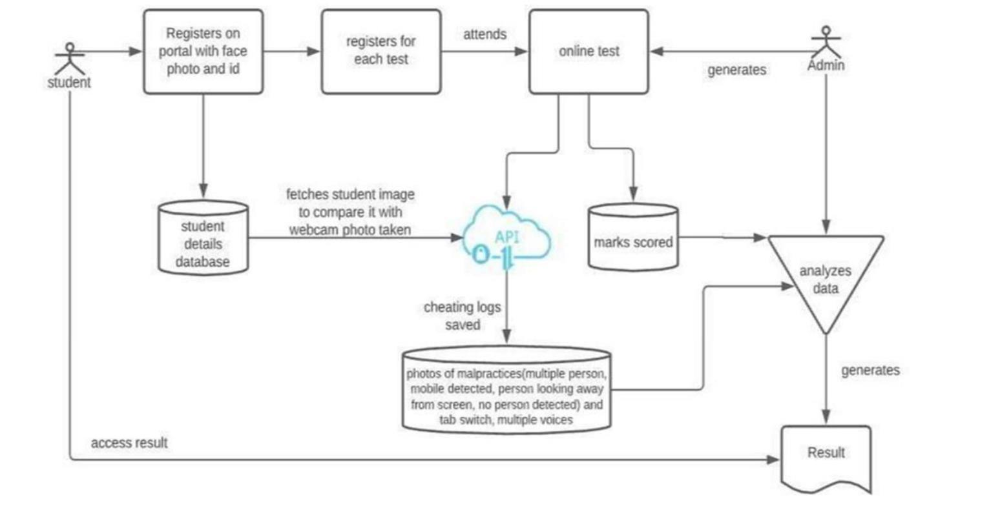

## Table of Contents

- [Tech Stack](#tech-stack)

  - [Backend](#backend)
  - [Frontend](#frontend)

- [Current Functionality](#current-functionality)
  - [User Authentication and Role Management](#user-authentication-and-role-management)
  - [Teacher Capabilities](#teacher-capabilities)
  - [Student Functionality](#student-functionality)
  - [AI Exam Proctoring](#ai-exam-proctoring)
- [Future Scope](#future-scope)
  - [Candidate Verification](#candidate-verification)
  - [Voice Recognition](#voice-recognition)
  - [Secure Exam Environment](#secure-exam-environment)
  - [Unified Portal](#unified-portal)
- [Project Screenshots](#project-screenshots)
  - [Login Page](#login-page)
  - [Teacher Dashboard](#teacher-dashboard)
  - [Exam Page](#exam-page)
  - [Cheat Log Dashboard](#cheat-log-dashboard)
- [How to Run](#how-to-run)
- [Contributors](#contributors)
- [License](#license)

## Tech Stack

ProctoAI-MERN utilizes a range of technologies to provide its comprehensive functionality. The key technologies and dependencies used in this project include:

### Backend

- **Node.js:** A JavaScript runtime for server-side development.
- **Express:** A minimal and flexible Node.js web application framework.
- **MongoDB:** A NoSQL database for storing user data.
- **Mongoose:** An elegant MongoDB object modeling tool.
- **JSON Web Tokens (JWT):** Used for secure authentication and authorization.
- **bcryptjs:** A library for securely hashing passwords.
- **Express-Async-Handler:** Middleware to handle exceptions in asynchronous route handlers.

### Frontend

- **React:** A JavaScript library for building user interfaces.
- **Redux Toolkit:** A library for state management in React applications.
- **TensorFlow.js:** An open-source machine learning framework for web-based applications.
- **Material-UI:** A popular React UI framework.
- **React-Router:** A routing library for React applications.
- **React-Toastify:** Used for displaying notifications.
- **React-Webcam:** A React component for capturing video from the user's webcam.
- **Yup:** A JavaScript schema builder for value parsing and validation.
- **Formik:** A library for building forms in React with form validation.
- **SweetAlert:** A JavaScript library for creating beautiful and responsive alert messages.

## Current Functionality

### User Authentication and Role Management

- Students and teachers can log in with separate roles and permissions.
- Secure authentication and authorization for user accounts.

### Teacher Capabilities

- Teachers can create exams and define questions.
- Exam management for teachers, including question creation and configuration.

### Student Functionality

- Students can view available exams and participate in them.
- The test page displays questions and a timer with an auto-submit feature.

### AI Exam Proctoring

- Real-time AI proctoring of students during exams.
- AI checks for cheating behaviors, such as mobile phone detection, multiple faces detection, and absence of detected faces.
- Cheating incidents are logged and viewable by teachers in their dashboard.

## Future Scope

### Candidate Verification

- Real-time candidate identity verification through image capture and matching with registered candidates.

### Voice Recognition

- Utilization of voice recognition technology to monitor and identify voice anomalies during online exams, identifying potential malpractice.

### Secure Exam Environment

- Preventing candidates from opening or accessing unauthorized applications on their desktop or mobile devices during the online exam.

### Unified Portal

- Creation of a unified portal for users to log in, access question papers, open a chat window for communication with the examiner, and upload answer sheets via an integrated scanner within the portal.

## Project Screenshots

### Login Page

- #### Student

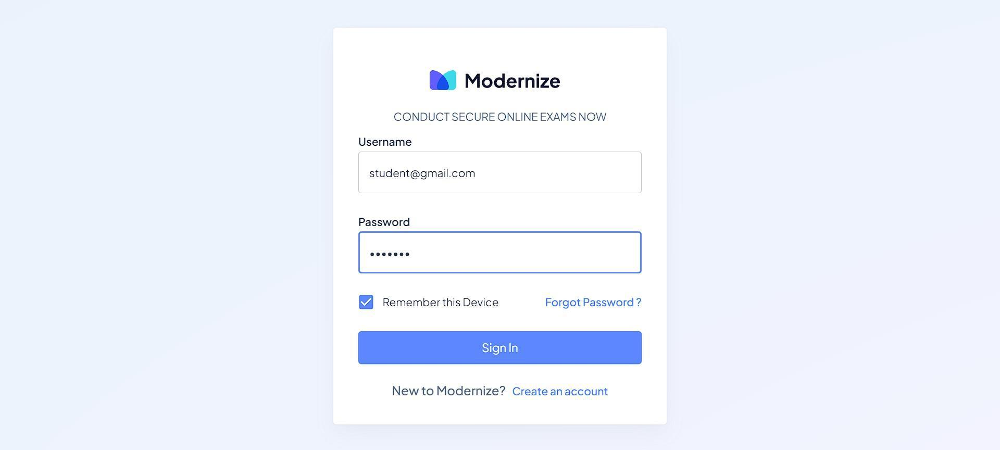

- #### Teacher


### Dashboard

- #### Student

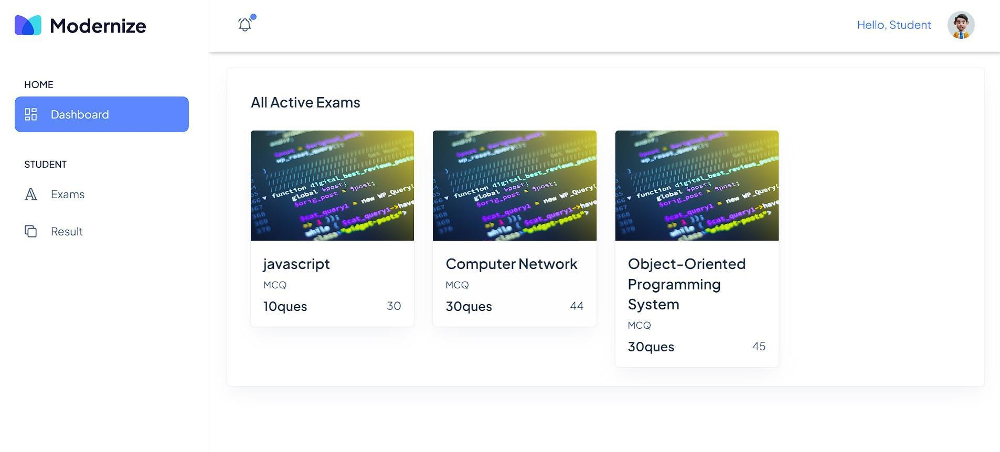

- #### Teacher

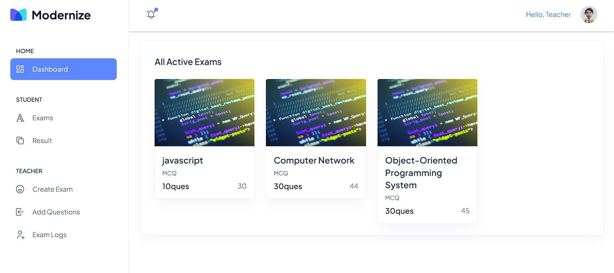

### Creating Exam Feature

- #### Create Exam

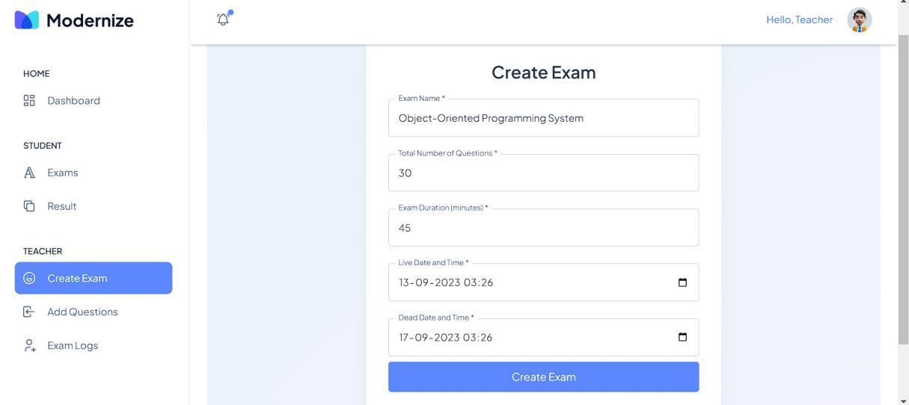

- #### Success

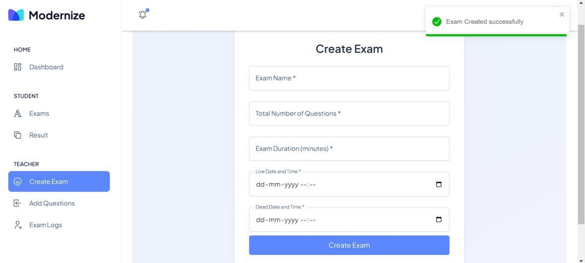

- #### Create Questions

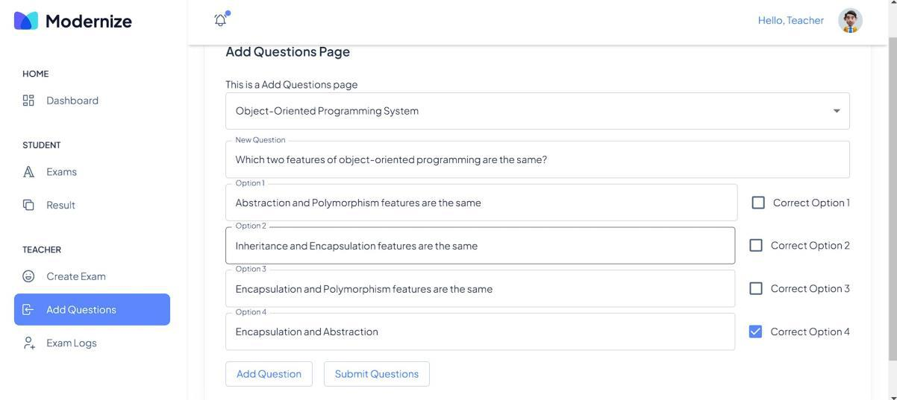

### Exam Page

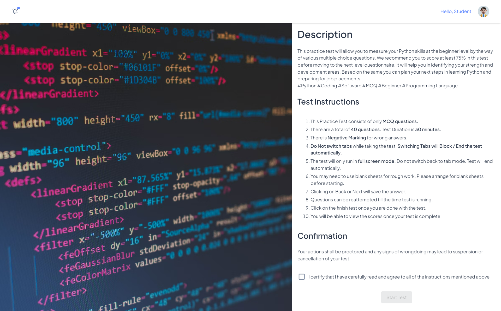

### Cheating Detection During Exam

- Webcam capture is hidden due to privacy reasons, with a black box covering the video feed.

#### Cell Phone Detection

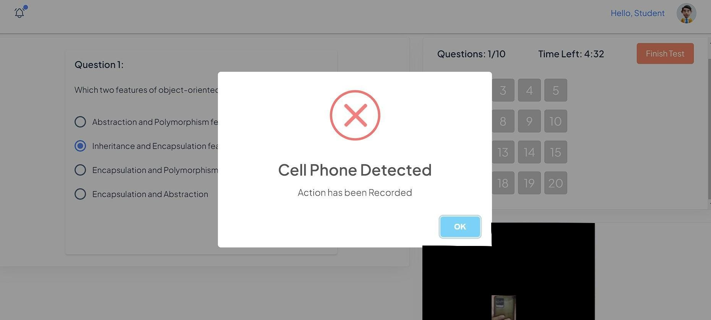

#### Prohibited Object Detection

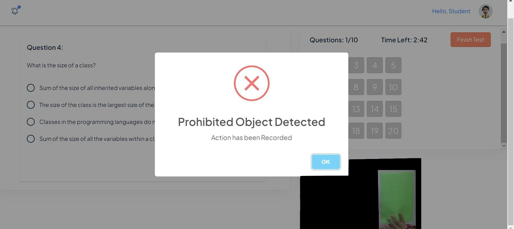

#### Face Not Visible Detection

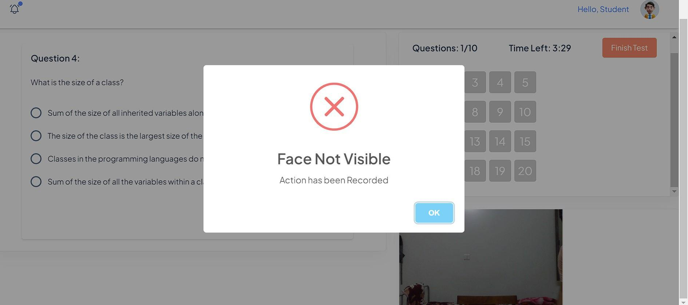

### Test Page

#### Start

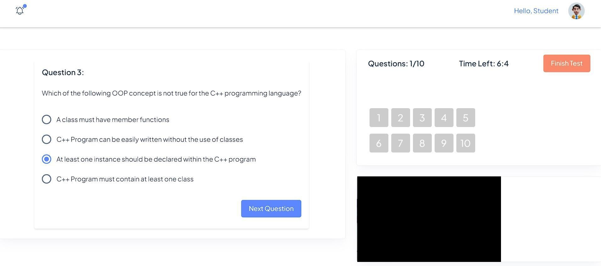

#### Submitted

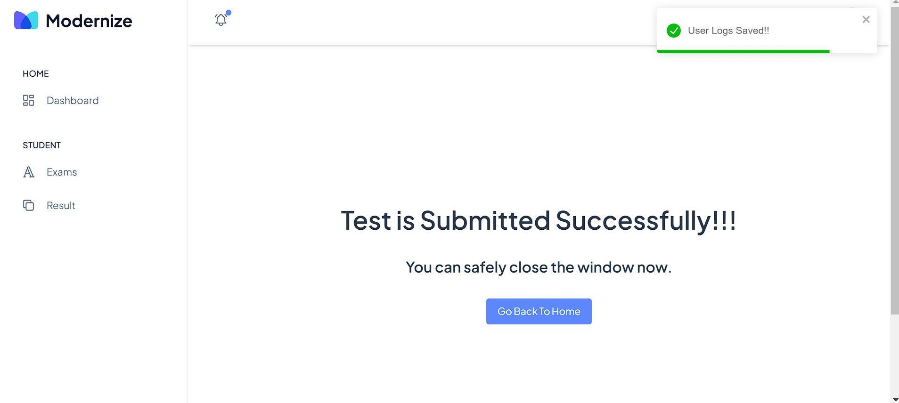

### Cheat Log Dashboard

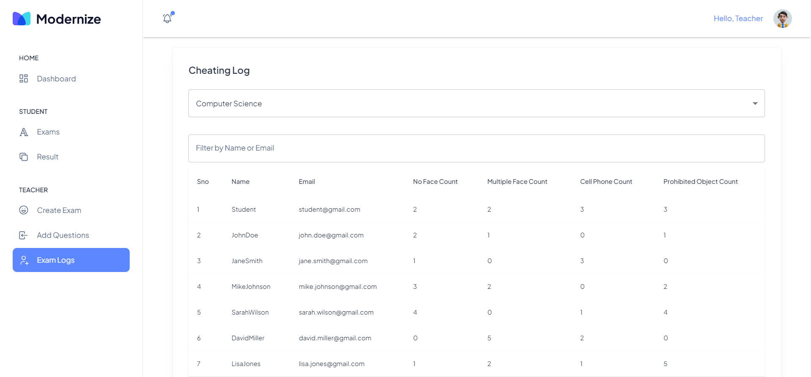

More features and improvements are in development and will be included in future updates.

## System Architecture

The application consists of three services:

1. **React frontend** - student and teacher dashboards, exams, webcam monitoring, and
   client-side proctoring.
2. **Node.js/Express backend** - authentication, exams, results, sessions, violations,
   file uploads, and Socket.IO signaling.
3. **Python FastAPI AI service** - YOLO11 object detection for people and mobile phones.

MongoDB stores application data used by the Node.js backend. During an exam, the
frontend sends selected camera frames to the AI service and reports proctoring
events to the Node.js backend.

## Project Structure

```text
Mega_project/
├── backend/
│   ├── config/             # Database and proctoring configuration
│   ├── controllers/        # Request handlers
│   ├── middleware/         # Authentication and error middleware
│   ├── models/             # Mongoose schemas
│   ├── routes/             # Express API routes
│   ├── scripts/            # Optional seed scripts
│   ├── services/           # Scoring and application services
│   └── server.js           # Node.js API and Socket.IO server
├── backend-ai/
│   ├── main.py             # FastAPI /detect and /health endpoints
│   ├── requirements.txt    # Python dependencies
│   └── yolo11n.pt          # YOLO11 model weights
├── frontend/
│   ├── public/             # Static frontend files
│   └── src/
│       ├── components/     # Shared UI components
│       ├── hooks/          # Webcam and proctoring hooks
│       ├── layouts/        # Application layouts
│       ├── routes/         # React Router configuration
│       ├── services/       # Frontend service clients
│       ├── slices/         # Redux Toolkit API/state slices
│       └── views/          # Authentication, student, and teacher pages
├── .env.example            # Environment variable template
├── package.json            # Backend and root development scripts
└── README.md
```

## Database

The backend uses MongoDB through Mongoose. The default local database is:

```text
mongodb://localhost:27017/proctoai
```

The application stores users, exams and questions, exam sessions, results, OTP
records, and proctoring violation events. MongoDB creates collections as the
application first uses each model.

## Configuration

Copy the root environment template:

```powershell
Copy-Item .env.example .env
```

Set at least these values in `.env`:

```env
NODE_ENV=development
PORT=5000
MONGO_URL=mongodb://localhost:27017/proctoai
JWT_SECRET=replace_with_a_long_random_secret
```

Optional SMTP variables enable email OTP delivery. If SMTP is not configured,
development OTP values are logged by the backend. For Uploadcare evidence
uploads, configure `REACT_APP_UPLOADCARE_PUBLIC_KEY` in `frontend/.env`.

Never commit `.env`, frontend secrets, uploaded evidence, virtual environments,
or dependency directories.

## Installation

Install JavaScript dependencies from the repository root:

```powershell
npm install
npm install --prefix frontend
```

Install the AI service dependencies into the root virtual environment:

```powershell
py -m venv .venv
& ".\.venv\Scripts\python.exe" -m pip install -r ".\backend-ai\requirements.txt"
```

If PowerShell blocks environment activation, run
`Set-ExecutionPolicy -Scope Process Bypass` for the current terminal.

## How to Run

Start MongoDB before starting the application. On Windows, if MongoDB is
installed as a service, use:

```powershell
net start MongoDB
```

### Terminal 1: all development services

From the repository root:

```powershell
npm run dev
```

This starts the Node.js backend, React frontend, Python AI service, and the
configured ngrok tunnel together. The AI service uses the root `.venv`.

The AI service runs on `http://localhost:8000`. Verify it at
`http://localhost:8000/health`.

Open the application at:

```text
http://localhost:3000
```

### Use port 3001 with ngrok

When a public tunnel is required, run the frontend on port 3001:

```powershell
cd frontend
$env:PORT=3001
npm start
```

In another terminal, expose that frontend:

```powershell
ngrok http 3001
```

Use the HTTPS URL shown by ngrok. The Node backend and AI service still run
on ports 5000 and 8000.

## Available npm Scripts

Run these commands from the repository root:

| Command | Purpose |
| --- | --- |
| `npm run dev` | Start the Node backend, React frontend, AI service, and ngrok tunnel |
| `npm run server` | Start only the Node backend with nodemon |
| `npm run client` | Start only the React frontend |
| `npm run ai` | Start only the Python AI service |
| `npm run dev:tunnel` | Start the development services with ngrok |
| `npm run build --prefix frontend` | Create the React production build |

## Demo Data

After MongoDB is running, optionally seed demo users:

```powershell
node backend/scripts/seed.js
```

Teachers are created through the seed/database workflow rather than public
student registration.

## Service Health Checks

```text
Frontend: http://localhost:3000
Node API: http://localhost:5000
AI API: http://localhost:8000/health
```

If the AI service reports `No module named uvicorn`, install its dependencies
using the same Python executable that starts the service:

```powershell
& ".\.venv\Scripts\python.exe" -m pip install -r ".\backend-ai\requirements.txt"
```

## GitHub Upload

Before pushing, confirm that secrets and generated files are ignored:

```powershell
git status
```

Do not commit `.env`, `node_modules`, `.venv`, `backend-ai/.venv`,
`backend/uploads`, `__pycache__`, or private credentials. To push this project
to a new GitHub repository:

```powershell
git init
git add .
git commit -m "Initial ProctoAI project"
git branch -M main
git remote add origin https://github.com/YOUR_USERNAME/YOUR_REPOSITORY.git
git push -u origin main
```

Replace `YOUR_USERNAME` and `YOUR_REPOSITORY` with the GitHub repository details.
